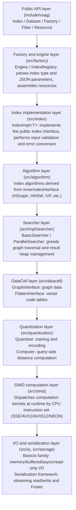

# Feature Introduction

<!-- md-trans-meta sourceCommit=8085279f6cf821bce464666389b13ac09eee25ce translatedAt=2026-11-13T09:18:54.835Z pushedAt=2026-11-16T09:18:54.144Z -->

This document introduces the layered architecture and algorithm principles of vsag. It covers the HGraph main indexing algorithm and core optimization features, such as RaBitQ 4-bit table lookup, Computer object pooling and reuse in the preprocessing stage, BFS graph-order base vector reordering, and batch4 distance computation for SQ8 and SQ8 Uniform, and is intended for users who need to understand the optimization features of vsag.

## Architecture

This section describes the logical structure of the main algorithms of vsag and the roles of the modules involved.

### Overall Layered Architecture

vsag adopts a top-down layered architecture, in which layers are decoupled through abstract interfaces, making it easy to replace and optimize each layer independently. A typical search call goes through the following layers from top to bottom:



### Module Descriptions

| Module (Source Code Directory) | Core Classes/Interfaces | Role |
| --- | --- | --- |
| Public API layer (include/vsag) | Index, Dataset, Factory | Stable interfaces exposed externally. Users create indexes through `Factory::CreateIndex` with JSON parameters. |
| Factory and engine layer (src/factory) | Engine, IndexRegistry | Index type registration and creation dispatch; manages shared resources such as thread pools and allocators. |
| Index implementation layer (src/index) | IndexImpl&lt;T&gt; | Templated wrapper layer that adapts internal indexes to the public Index interface, and uniformly handles input validation, error code conversion, and index feature switches. |
| Algorithm layer (src/algorithm) | InnerIndexInterface, HGraph, HNSW, IVF | Implementations of each index algorithm, responsible for graph building, entry points for insertion/deletion/update/query, and index-level policies. |
| Searcher layer (src/impl/searcher) | BasicSearcher, ParallelSearcher | Greedy search process on the graph: candidate expansion, visit deduplication, and distance heap convergence, supporting both single-threaded and parallel execution modes. |
| DataCell layer (src/datacell) | GraphInterface, FlattenInterface | Physical organization of data: graph adjacency lists (including sparse and compressed graphs), vector code tables, attribute inverted lists, extra information storage, etc. |
| Quantization layer (src/quantization) | Quantizer&lt;QuantT&gt;, Computer | Vector compression and distance computation: training/encoding/decoding are handled by the Quantizer; Computer holds the query preprocessing results and provides single-point, batch, and batch4 distance computation entries. |
| SIMD computation layer (src/simd) | Computation kernels in the `simd` namespace | Low-level distance computation kernels, organized by quantization type (SQ8, RaBitQ, PQ, etc.), dispatched at runtime to SSE/AVX2/AVX512/NEON implementations according to CPU capabilities. |
| I/O and serialization layer (src/io, src/storage) | BasicIo, StreamWriter/StreamReader | Index persistence: backends such as memory I/O, buffered I/O, mmap, and asynchronous I/O, as well as streaming serialization formats with Footer. |
| Common base components (src/impl, src/utils, src/attr) | Allocator, DistanceHeap, VisitedList, ResourceObjectPool, etc. | Memory allocators, distance heaps, visited bitmaps, label tables, thread pools, object pools, as well as attribute filter expressions and executors based on ANTLR4 grammar parsing. |

## Algorithm Principles

HGraph (hierarchical navigable graph) is the flagship graph index algorithm of vsag. Its core design is as follows:

- **Multi-layer graph structure**: The bottom graph (`bottom_graph_`) contains all vectors; the upper layers are several routing graphs (`route_graphs_`), whose node counts decay exponentially layer by layer. During search, it starts from the entry point of the topmost layer, greedily descends layer by layer to the bottom graph, and then performs fine-grained search on the bottom graph.
- **Dual code table design**:
  - Coarse code table (`basic_flatten_codes_`): Base vectors are stored after compression by a quantizer (such as RaBitQ), and the main search path computes quantized distances on it, reducing memory usage and memory access overhead.
  - Precise code table (`high_precise_codes_`, optional): Stores high-precision codes (such as SQ8), used to reorder candidate results to ensure recall.
- **Build path**: Supports both incremental insertion (NSW-style point-by-point edge building) and full build (ODescent global graph building), as well as cache-based accelerated incremental build.
- **Search path**: `HGraph::KnnSearch` calls `BasicSearcher::Search`, which iteratively performs the following loop: first get neighbors (`GraphInterface::GetNeighbors`), then compute quantized distances in batches (`FlattenInterface::Query` + `Computer`), and finally update the distance heap until convergence.

Other main algorithms:

- HNSW: Classic hierarchical graph index based on hnswlib
- IVF: Inverted file index, supporting GNO-IMI partitioning
- DiskANN: Disk index
- Pyramid: Segmented index
- SINDI: Sparse vector index
- BruteForce: Brute-force search

All the preceding algorithms reuse the same set of quantization, I/O, and base component facilities.

## Key Optimization Features

### RaBitQ 4-bit Table Lookup

#### Overview

A 4-bit table lookup path is added to RaBitQ 1-bit quantized distance computation, increasing the utilization of Arm SVE vector registers by increasing vector unrolling and instruction-level parallelism.

#### Algorithm Design

The original implementation adopts exact single-point computation with per-bit select + float32 multiply-accumulate, which has low computation efficiency. A 4-bit table lookup optimization is added, which adopts 4-bit nibble prebuilt float16 tables + SVE TBL lookup + float16 accumulation for high-throughput batch approximate computation, improving computation efficiency.

1. Query flow of RaBitQ 4-bit table lookup

    1) RaBitQFloatBuild4BitLookupTable: preprocesses the query vector and generates a lookup table in float16 format (four 16-bit floating-point numbers per group, dim/4 groups in total).

    2) RaBitQFloatBatchBinaryIPBy4BitLookup: splits the 4-bit codes of a batch of candidate vectors into nibbles (0-15), and obtains float32 inner product scores through table lookup accumulation.

2. Performance optimization ideas of the SVE path

    - Uses SVE `svld1uh_u64` (64-bit unsigned halfword load) + `svsli_n_u64` (shift and insert) to efficiently recombine scattered 4-bit codes into 16-bit index values.

    - Uses the `svzip1/2` interleaving instructions to transpose codes, unifying the interleaved layout into contiguous indexes for TBL lookup.

    - The main lookup loop is 32-way, using `SVE_INNER_LOOP_DOUBLE_BODY` to process lookups in batches. If the remainder is greater than or equal to 16, the original `SVE_INNER_LOOP_BODY` is used to process one 16-way chunk. If the remainder is less than 16, existing codes are used for padding, and `svwhilelt_b32` generates a predicate to mask invalid lanes, ensuring that only valid vectors are computed. This tail processing avoids sacrificing SIMD width.

#### Enabling Conditions

This optimization is enabled by setting `"rabitq_enable_batch": true` in `index_param` (false by default), and requires `rabitq_bits_per_dim_query=32` and `rabitq_bits_per_dim_base=1` simultaneously (these two are default values and do not need to be explicitly specified); otherwise, the normal per-item path is still used. This optimization is implemented jointly by a query-side prebuilt 4-bit lookup table and a batch (transposed) distance computation kernel.

> **NOTE:**
> SIMD acceleration is available only on the Arm platform when the CPU supports SVE2 + SVE-bitperm.
> On hardware that does not support SVE2-bitperm (including x86 and SVE1-only Arm), no error is reported, and the system automatically falls back to the generic implementation.

### Computer Object Pooling and Reuse in the Preprocessing Stage

#### Overview

In the preprocessing stage, Computer objects are redundantly created. To address this, a request-level Computer object pool, QueryComputerPool, is introduced. For the same query on the same flatten/quantizer, the Computer is created only once and cached in the pool. When acquired in each search stage, it is reused directly on a cache hit, thereby reducing redundant preprocessing overhead.

#### Algorithm Design

In the original flow, one search is divided into three serial stages, and each stage calls FactoryComputer for the same query.

```text
SearchWithRequest(query)
  ├─ Route Graph search    → FactoryComputer(query)   // L times (L is the number of routing graph layers, once per layer)
  ├─ Bottom Graph search   → FactoryComputer(query)   // Once
  └─ Reorder               → FactoryComputer(query)   // Once
```

Repeated calls to FactoryComputer cause the same query to repeatedly perform preprocessing, such as ROM transform, normalize, and lookup build, on the same flatten/quantizer. After the optimization, the workflow is as follows:

- **Pool construction location**: QueryComputerPool is constructed at the top level of `HGraph::SearchWithRequest` (bound to the current query) and passed to each search stage through `QueryContext.computer_pool`.
- **Unified entry for downstream modules to acquire a Computer**: Downstream modules such as BasicSearcher, ParallelSearcher, and FlattenReorder uniformly acquire Computers through `AcquireQueryComputer`. This entry looks up by code table identity in the pool: on a hit, the cached Computer is reused directly; on a miss, `FactoryComputer` is called to create one, and the newly created Computer is cached in the pool.
- **Two cases in the reorder stage**: If reorder uses base codes (`reorder_by_base_`), it hits the existing `basic_computer` in the pool; if reorder uses `high_precise_codes_`, a separate Computer is created for the precise code table and likewise cached in the pool for subsequent reuse.
- **Configuration conditions and optimization benefits**: When `use_reorder` is set to `true` in the configuration file and reorder uses the precise code table, this optimization reduces the original L+2 preprocessing passes to 2, cutting redundant preprocessing overhead.

#### Enabling Conditions

This optimization requires no parameter configuration and takes effect by default during HGraph search.

### BFS Graph-Order Base Vector Reordering

#### Overview

Uses the BFS graph order to reorder the IDs of base vectors. While keeping the graph topology unchanged, it maximizes the local continuity of neighbor node IDs, improving cache utilization and access speed.

#### Algorithm Design

After the index is built, the physical storage order of base vectors depends on the insertion order, which is not fully consistent with the actual access pattern during graph search. In the search stage, expansion starts from `entry_point` along graph edges, and the sequence of visited vector IDs usually exhibits jump characteristics, which easily reduces the cache hit rate. After the index is deserialized, this optimization generates a BFS-like permutation based on `entry_point` and graph adjacency, and performs consistent physical reordering and ID mapping updates on internal ID-related storage such as `basic_flatten_codes`, `bottom_graph`, `route_graph`, and `label_table`. After reordering, adjacent or near-layer nodes on the graph are more likely to be located in nearby positions in physical storage, thereby improving the spatial locality of candidate IDs and cache line utilization.

#### Enabling Conditions

This optimization requires no parameter configuration and is executed automatically after the index is loaded (deserialized). It takes effect only in the SVE branch and requires that the index does not enable features such as deletion, duplicate labels, attribute filtering, or extra information.

### Batch4 Distance Computation for SQ8 and SQ8 Uniform

#### Overview

The SQ8 and SQ8 Uniform distance computation paths implement batch4 distance computation to support a single query performing batch distance computation against four base vectors simultaneously.

#### Algorithm Design

The existing SQ8 and SQ8 Uniform distance computation uses a form in which one query and one base vector are computed at a time. Batch4 distance computation loads one query and four base vectors at a time and computes them simultaneously. In each iteration, the shared inputs are loaded only once (query/lower_bound/diff for SQ8, and the uint8 encoding of the query for SQ8 Uniform). The four codes each maintain an independent accumulator, and finally horizontal reduction yields four results, reducing repeated memory reads and improving instruction-level parallelism. The internal computation of the two paths is as follows:

- SQ8: Each code only needs a single flow of uint8 zero-extension to uint32 -> conversion to float32 -> multiply-accumulate/multiply-subtract to complete the distance accumulation after shared-term splitting.
- SQ8 Uniform: The SVE `svdot` integer dot product instruction is used to directly compute the uint8×uint8 dot product and accumulate it into four independent uint32 accumulators, followed by horizontal reduction and uniform metric correction.

#### Enabling Conditions

This optimization requires no additional parameter configuration and takes effect automatically when the quantization type of the index is set to `sq8` or `sq8_uniform`.

## Change History

| Version | Date | Description |
| ---- | ---- | ---- |
| 01 | 2026-12-30 | This is the first official release. |
