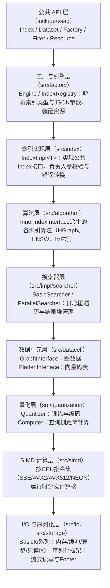

# 特性介绍

本文档介绍vsag的分层架构与算法原理，涵盖HGraph主索引算法及RaBitQ 4bit查表、预处理阶段Computer对象池化复用、BFS图序底库重排、SQ8和SQ8 Uniform batch4距离计算等核心优化特性，适用于需要了解vsag优化特性的用户。

## 架构介绍

本节介绍vsag主要算法的逻辑结构与所包含的模块含义及作用。

### 总体分层

vsag采用自上而下的分层架构，各层之间通过抽象接口解耦，便于独立替换与优化。一次典型的搜索调用自上而下经过如下各层：



### 各模块含义及作用

| 模块（源码目录） | 核心类/接口 | 作用 |
| --- | --- | --- |
| 公共 API 层（include/vsag） | Index、Dataset、Factory | 对外暴露的稳定接口，用户通过Factory::CreateIndex以JSON参数创建索引 |
| 工厂与引擎层（src/factory） | Engine、IndexRegistry | 索引类型注册与创建分发，管理线程池、分配器等共享资源 |
| 索引实现层（src/index） | IndexImpl&lt;T&gt; | 模板化包装层，将内部索引适配为公共Index接口，统一处理入参检查、错误码转换与索引特性开关 |
| 算法层（src/algorithm） | InnerIndexInterface、HGraph、HNSW、IVF | 各索引算法的实现，负责建图、增删改查入口与索引级策略 |
| 搜索器层（src/impl/searcher） | BasicSearcher、ParallelSearcher | 图上的贪心搜索过程：候选扩展、访问去重、距离堆收敛，支持单线程与并行两种执行模式 |
| 数据单元层（src/datacell） | GraphInterface、FlattenInterface | 数据的物理组织：图邻接表（含稀疏图、压缩图）、向量码表、属性倒排表、附加信息存储等 |
| 量化层（src/quantization） | Quantizer&lt;QuantT&gt;、Computer | 向量压缩与距离计算：训练/编码/解码由Quantizer承担；Computer持有查询预处理结果，提供单点、批量、batch4等距离计算入口 |
| SIMD 计算层（src/simd） | simd命名空间各计算核 | 底层距离计算核，按量化类型（SQ8、RaBitQ、PQ等）组织，运行时按CPU能力分发到SSE/AVX2/AVX512/NEON实现 |
| I/O 与序列化层（src/io、src/storage） | BasicIo、StreamWriter/StreamReader | 索引持久化：内存I/O、缓冲I/O、mmap、异步I/O等后端，以及带Footer的流式序列化格式 |
| 公共基础组件（src/impl、src/utils、src/attr） | Allocator、DistanceHeap、VisitedList、ResourceObjectPool等 | 内存分配器、距离堆、访问位图、标签表、线程池、对象池，以及基于ANTLR4语法解析的属性过滤表达式与执行器 |

## 算法原理

HGraph（分层可导航图）是vsag的主力图索引算法，其核心设计如下：

- **多层图结构**：底层图（`bottom_graph_`）包含全部向量；上层为若干路由图（`route_graphs_`），节点数逐层指数衰减。搜索时从最上层入口点出发，逐层贪心下降至底层，再在底层完成精细搜索。
- **双码表设计**：
  - 粗码表（`basic_flatten_codes_`）：底库向量经量化器（如RaBitQ）压缩后存放，搜索主链路在其上计算量化距离，降低内存占用与访存开销。
  - 精码表（`high_precise_codes_`，可选）：存放高精度编码（如SQ8），用于对候选结果重排（reorder），保证召回率。
- **构建链路**：支持增量插入（NSW式逐点建边）与全量构建（ODescent全局建图）两种方式，并支持基于缓存的增量构建加速。
- **搜索链路**：`HGraph::KnnSearch` 调用 `BasicSearcher::Search`，后者循环执行“先取邻居（`GraphInterface::GetNeighbors`），再批量计算量化距离（`FlattenInterface::Query` + `Computer`），最后更新距离堆”，直至收敛。

其他主要算法：

- HNSW：基于hnswlib的经典分层图索引
- IVF：倒排文件索引，支持GNO-IMI分区
- DiskANN：磁盘索引
- Pyramid：分段索引
- SINDI：稀疏向量索引
- BruteForce：暴力检索

以上算法均复用同一套量化、I/O与基础组件设施。

## 核心优化特性

### RaBitQ 4bit查表优化

#### 功能描述

RaBitQ 1bit量化距离计算增加4bit查表路径，通过增大向量展开度和指令级并行度，增加ARM SVE向量寄存器的利用率。

#### 算法设计

原生采用逐bit select+float32乘加的精确单点计算，计算效率较低，现增加4bit查表优化，采用4bit nibble预建float16表+SVE TBL查表+float16累加的高吞吐批量近似计算，提高计算效率。

1. RaBitQ 4bit查表的查询流程

    1) RaBitQFloatBuild4BitLookupTable：对查询向量做预处理，生成一个float16格式的lookup table（每组4个16位浮点数，共dim/4组）。

    2) RaBitQFloatBatchBinaryIPBy4BitLookup：对一批候选向量的4bit code做拆分取nibble（0-15），通过查表累加得到float32内积分数。

2. SVE路径性能优化思路

    - 利用SVE的`svld1uh_u64`（64位无符号半字加载）+ `svsli_n_u64`（移位插入）将分散存储的4bit code高效重组为16bit索引值。

    - 通过`svzip1/2`交叉解压指令实现code转置，将交错布局统一为连续索引以供TBL查表。

    - 查表主循环为32路，使用`SVE_INNER_LOOP_DOUBLE_BODY`批量处理查表。如果余数大于等于16，用原始`SVE_INNER_LOOP_BODY`处理一个16路chunk。如果不足16，使用已有的code填充补位，`svwhilelt_b32`生成谓词屏蔽无效通道，保证只计算有效向量，使用该尾处理方式避免牺牲SIMD宽度。

#### 开启条件

该优化点在index_param中设置`"rabitq_enable_batch": true`开启（默认 false），且需同时满足rabitq_bits_per_dim_query=32、rabitq_bits_per_dim_base=1（这两项配置为默认值，无需显式指明），否则仍走逐条普通路径。该优化由查询侧预构建4-bit查表和批量（转置）距离计算内核共同实现。

> **说明：**
> SIMD加速仅在ARM平台且CPU支持SVE2+SVE-bitperm时可用。
> 在不支持SVE2-bitperm的硬件（含 x86、SVE1-only ARM）上不会报错，会自动回退到通用实现。

### 预处理阶段Computer对象池化复用

#### 功能描述

预处理阶段Computer对象存在冗余创建的情况。引入请求级Computer对象池QueryComputerPool，同一query在同一flatten/quantizer上的Computer只创建一次并缓存于池中，各搜索阶段获取时命中即直接复用，从而减少重复预处理开销。

#### 算法设计

原始流程中一次搜索分三个串行阶段，每个阶段分别对同一个query调用FactoryComputer。

```text
SearchWithRequest(query)
  ├─ Route Graph搜索    → FactoryComputer(query)   // L次（L为路由图层数，每层1次）
  ├─ Bottom Graph搜索   → FactoryComputer(query)   // 1次
  └─ Reorder重排序      → FactoryComputer(query)   // 1次
```

反复调用FactoryComputer会导致同一个query在相同flatten/quantizer上重复执行预处理，例如ROM transform、normalize、lookup build等。优化后按如下方式处理：

- **池的构造位置**：在HGraph::SearchWithRequest顶层构造QueryComputerPool（绑定当前query），并通过QueryContext.computer_pool传递给各搜索阶段。
- **下游获取Computer的统一入口**：BasicSearcher、ParallelSearcher、FlattenReorder等下游模块统一通过AcquireQueryComputer获取Computer。该入口在池内按码表身份查找：命中则直接复用缓存的Computer；未命中才调用FactoryComputer创建，并将新建的Computer缓存入池。
- **reorder阶段的两种情形**：若reorder使用base codes（reorder_by_base_），则命中池中已有的basic_computer；若reorder使用high_precise_codes_，则为精码表单独创建一个Computer，同样缓存于池中供后续复用。
- **配置条件与优化收益**：在配置文件中将use_reorder设置为true，且reorder使用精码表时，该优化将原先的L+2次预处理精简为2次，减少重复预处理开销。

#### 开启条件

该优化点无需参数配置，hgraph搜索时默认生效。

### BFS图序底库重排

#### 功能描述

使用BFS图序重排底库的ID，在保持图拓扑结构不变的前提下，最大化邻居节点ID的局部连续性，可以提高缓存利用率和访问速度。

#### 算法设计

索引构建完成后，底库向量的物理存储顺序取决于添加顺序，与图搜索阶段的实际访问模式不完全一致。搜索阶段从 entry_point 出发沿图边扩展，访问的向量 id 序列通常呈跳跃特征，容易降低 cache 命中率。该优化在索引反序列化完成后，根据 entry_point 和图邻接关系生成类似BFS的排列方式，并对 basic_flatten_codes、bottom_graph、route_graph、label_table 等内部 id 相关存储做一致的物理重排和 id 映射更新。重排后，图上相邻或近层节点在物理存储中更可能落在相近位置，从而改善候选 id 的空间聚集性和 cache 行利用率。

#### 开启条件

该优化点无需参数配置，加载（反序列化）索引后自动执行。该优化点仅在SVE分支生效，且要求索引未启用删除、重复标签、属性过滤、附加信息等特性。

### SQ8和SQ8 Uniform batch4距离计算优化

#### 功能描述

SQ8和SQ8 Uniform距离计算路径实现batch4距离计算，以支持单查询同时与4条底库向量进行批量距离计算。

#### 算法设计

现有的SQ8和SQ8 Uniform距离计算采用1条查询与1条底库向量计算的形式，batch4距离计算一次性加载1条查询与4条底库向量后同时计算，每次迭代只加载一次共享输入（SQ8为query/lower_bound/diff，SQ8 Uniform为query的uint8编码），4个码各自维护独立累加器，最后水平归约得到4个结果，减少重复内存读，提升指令并行度。两条路径的内部计算方式如下。

- SQ8：每条码只需一次uint8零扩展为uint32->转换为float32->乘累加/乘累减的流程即可完成共享项拆分后的距离累加。
- SQ8 Uniform：利用SVE的svdot整数点积指令直接计算uint8×uint8点积并累加到4个独立的uint32累加器，水平归约后统一做度量修正。

#### 开启条件

该优化点无需额外参数配置，索引的量化类型设置为`sq8`或`sq8_uniform`时自动生效。

## 修订记录

| 文档版本 | 发布日期 | 修改说明 |
| ---- | ---- | ---- |
| 01 | 2026-12-30 | 第一次正式发布。|
